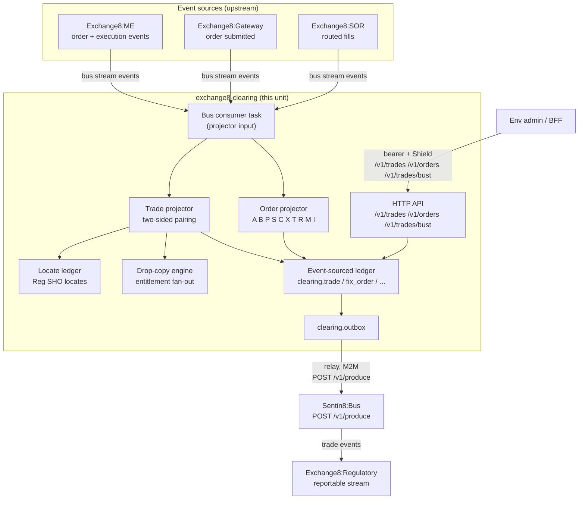

# README.md: Exchange8:Clearing

## 1. Summary

Exchange8:Clearing is the event-sourced order/trade ledger of the exchange8 vertical
(binary `exchange8-clearing`, service type `exchange8:clearing`). It consumes
order/trade lifecycle events from the venue flow and projects them into a
deterministic SQL ledger (`clearing` schema, database `exchange8`), serves the
trade/order query and trade-bust API, maintains the short-sale locate ledger,
and fans out per-client drop-copy streams on per-drop sequences with a resend
store. It does not authorize or match anything - matching lives in Exchange8:ME, risk
limits in Exchange8:Risk, settlement in Exchange8:Settlement, and regulatory transport in
Exchange8:Regulatory.

## 2. Motivation

- **Deterministic rebuild.** Order and trade state must be reconstructible
  purely from the event stream; the ledger is the projection, not the source
  of truth.
- **Audit-grade trade journal.** Regulators and ops need one-row-per-side
  executions with a shared trade id, charges, and bust/amend history that
  never loses an original value.
- **Clearing-client drop copy.** Clearing firms need an entitled, filtered
  copy of executions (fills-only or all), with per-session sequences and
  reconnect resends.
- **Short-sale protection.** Reg SHO requires a locate before a short sale;
  the locate ledger ties borrow inventory to approved, consumable, expiring
  locates.
- **Idempotent busts.** Trade busts are step-up-authorized commands that must
  be exactly-once effects: replay-safe at the DB layer and fan-out events
  downstream (market data, gateway re-reports, drop copies).

## 3. Architecture & High-Level Design

The service is a Rust axum binary built on the shared platform shell
(`sentin8::shell`): registration (`--print-registration`), the
`EXCHANGE8_CLEARING_DATABASE_URL` pool, the `/v1/health` endpoint, the Shield
drain. Domain logic lives in pure modules (projectors, locate ledger, drop
engine, regulatory stream, bust ledger, purge policy) that the shell binds to
persistence and messaging. Externally the service is database-per-vertical /
schema-per-service: database `exchange8`, schema `clearing`, role
`exchange8_clearing_service` (no BYPASSRLS), its own DCR-registered cert-bound
M2M client, and its own audit + TLS workloads.

The HTTP router exposes the ledger query API and the bust endpoint; admin/RFW
data endpoints (`/v1/admin/trades`, `/v1/admin/orders`) alias the same
handlers, and the platform Shield admin API is mounted by the shell.

## 4. Key Traits and Data Structures

- **Event-sourced ledger.** Projectors are pure functions from the ME/SOR
  event stream to ledger rows: order lifecycle events become the one-letter
  order-update journal (`A` new-pending, `B` booked, `P` accepted, `S` posted,
  `C` cancel-pending, `X` cancelled, `T` traded, `R` replace-pending,
  `M` replace-done, `I` repriced); executions pair two side-events sharing a
  `trade_id` into the one-row-per-side `TRADE` shape.
- **Trade projector.** Holds per-`trade_id` pairing state: completed pairs
  emit both side rows in taker-then-maker order; one-side-arrived events wait
  in a pending buffer (the projection-gap alert source); duplicate sides,
  same-liquidity pairs, and price/qty mismatches are recorded as anomalies
  while still projecting the data for repair.
- **Locate ledger.** Instrument-scoped, qty-capped, time-boxed borrow
  reservation: inventory is replaced in full from the lending desk feed; a
  locate request fits the *unreserved* availability (inventory minus
  outstanding unconsumed unexpired locates); consumption is oldest-first; a
  24-hour validity window and the expiry sweep release reservations.
- **Drop-copy fan-out.** Per-client entitlement configuration (fills-only
  mode, customer/trader/book-token junctions, instrument allow-lists) filters
  the lifecycle stream into per-client buffers; a global ingest sequence plus
  the persisted per-connection `seq_no` store support reconnect resends.

## 5. Rationale, Trade-offs, and Alternatives

- **SQL projection with a Bus outbox, not a ledger-only database.** Rows are
  written in the same transaction as a `clearing.outbox` INSERT, so the ledger
  and its published events commit atomically; a relay pushes the outbox to
  Sentin8:Bus. An alternative - publishing before commit, or a separate
  change-data-capture process - risks ledger/event divergence or adds
  infrastructure the platform already provides.
- **Pure-core projectors with a thin shell.** All projection, pairing, locate,
  fan-out, and bust logic is deterministic, dependency-free Rust
  (`services/clearing/src/projector.rs`, `locate.rs`, `drop_copy.rs`);
  persistence, token handling, and event transport stay in the shell. This
  makes replay and golden tests DB-free and keeps the DB layer auditable.
- **One-row-per-side trades preserved.** Merging the two side-events into a
  single logical row would simplify reads but breaks clearing compatibility
  and the counterparty/liquidity parity contract downstream consumers rely
  on; the pair state lives in the projector, not the table shape.
- **Dedicated pairing/anomaly state instead of silent repair.** Duplicates and
  mismatched sides are ME-visible defects; silently correcting them would hide
  upstream bugs. The projector records anomalies and keeps the data.
- **Idempotent busts at the DB layer.** `clearing.bust_trade` is unique on
  `(env_id, trade_id)` with `ON CONFLICT ... DO NOTHING` and the trade rows
  are marked either way, so replays of the same bust command are cheap no-ops
  rather than duplicate events.

## 6. Internal Implementation & Invariants (Private Design)

- **Same-connection tenant context.** Every handler acquires a connection,
  opens a transaction, awaits `set_tenant_context` on that same transaction,
  and then queries it - the RLS context is transaction-local
  (`set_config(..., true)`). Invariant: context-set and data query ride the
  same transaction, and the async context helper is always `.await`ed.
- **Three-way scope parity.** The handler scope constants, the handler
  authorization-matrix test, and the Shield scope-mirror policy text are kept
  identical by tests: a scope change must land in all three or the suite
  fails. Scope is the pre-filter; the Shield engine decides; the mirror set
  is `mode='enforced'` and enrolled as `origin='platform'`.
- **Idempotency keys.** Trade busts dedupe on `(env_id, trade_id)`;
  drop messages dedupe on `(connection_id, seq_no)`; outbox produce uses the
  row id as the Bus idempotency key - at-least-once relay plus idempotent
  sinks yields effectively-once.
- **RLS backstop.** Every `clearing` table (including outbox and audit
  journal) is `ENABLE`+`FORCE`d with `env_id = sentin8_current_env_id()`
  policies; handlers still carry explicit `WHERE env_id = $1` clauses as
  defense-in-depth. The service role has no BYPASSRLS.
- **Purge stays local.** Retention deletion targets only `clearing.drop_message`
  (2555-day regulatory keep); deleting other services' message stores from
  here is prohibited - purge is owning-service scoped.

## 7. Unresolved Questions / Future Designs

- **Wire-in of the pure cores.** The order/trade projectors, drop engine,
  regulatory stream, locate ledger, and purge policy are implemented and
  unit-tested as pure modules, but the Bus consumer task, drop FIX sessions,
  lending-feed adapter, and Cron purge proxy-back wiring are not yet driven
  from `main.rs` - the runtime currently serves the HTTP ledger API only.
- **RFW UI endpoints.** Registration declares the `drops`, `trades`, and
  `orders` admin pages (`/v1/admin/ui/...`), but no UI-definition handlers
  are mounted in the router yet; only the data endpoints are live.
- **Locate persistence.** The locate ledger is in-core only; no locate table
  exists in this service's schema yet, and the borrow-inventory feed adapter
  (securities-lending/prime-broker) is unwired.
- **Novation/collateral/give-up/block trades.** The real-time CCP novation,
  collateral management, give-up/give-in, and block-trade/EFP capabilities of
  the clearing-depth design are not in this service yet.
- **Bust reason scope name.** The design doc names the bust scope
  `exchange8:trade:bust:execute`; the registered and enforced scope is
  `exchange8:trade:bust` - the registry is the authority today.

---

**Design attribution:** exchange8:clearing and its underlying concepts were designed by Hamid Jahanzad <Hamid@Jahanzad.com>.
